<div align="center">

# 🛡️ PayPal Agent Shield
### **Zero-Trust Cryptographic Firewall & CFO Control Plane for Autonomous Agentic Commerce**

[](https://paypalaihackathon.devpost.com/)
[](https://google.github.io/adk-docs/)
[](./ap2_crypto.py)
[](./paypal_apimatic_client.py)
[](./shield_server.py)
[](./frontend/src/components/BryntumTaskBoardView.tsx)
[](./frontend/src/components/PolicyDashboard.tsx)
[](./shield_workflows.py)

*Empowering AI Agents to buy autonomously across 100M+ real products—while mathematically guaranteeing they can never hallucinate prices, exceed CFO budgets, or leak PayPal credentials.*

</div>

---

## 🚨 The Problem: Why Enterprise Agentic Commerce is Blocked Today

Autonomous AI agents can already browse catalogs and reason about purchases, but **no CFO will give an LLM direct access to a corporate PayPal account**. Why?
1. **LLM Price & SKU Hallucinations:** An agent might hallucinate a `$1.00` price or a fake SKU and trigger an invalid settlement.
2. **Prompt Injection & Unauthorized Spend:** A compromised prompt could instruct an agent to drain a corporate balance beyond approved limits.
3. **In-Transit Payload Tampering (MitM):** Without cryptographic non-repudiation between the human policy maker and the AI agent, checkout payloads can be altered before reaching the payment rail.
4. **Secret Exposure:** Passing raw payment credentials into an LLM context window is a critical security anti-pattern.

---

## 💡 The Solution: PayPal Agent Shield

**PayPal Agent Shield** is a complete **Zero-Trust Agentic Commerce Firewall & Unified Governance Console** built on **Google ADK**, the **AP2 (Agent Payments Protocol)** cryptographic model, **Channel3**, **AG Grid**, **Render Workflows**, and the **PayPal APIMatic Python SDK**.

Instead of trusting the LLM's text output, **PayPal Agent Shield** enforces a **5-Gate Deterministic & Cryptographic Verification Pipeline** before any transaction is settled on **PayPal Sandbox**:

1. **🔐 Dual-Identity Ed25519 Cryptography (`ap2_crypto.py`):**
   - **CFO Governance Keypair:** Signs budget policies directly from **AG Grid** (`AP2_POLICY_V1`).
   - **ADK Procurement Agent Keypair:** Signs every checkout intent (`AP2_CHECKOUT_V1`), binding the item SKU, total amount, merchant PayPal email, and the parent CFO Policy SHA-256 hash.
2. **🧠 Anti-Hallucination Ground-Truth Synchronization (`Channel3` -> `Shield`):**
   - When the agent searches the **Channel3 Product Graph (100M+ products)**, the Shield Control Plane intercepts and registers the official SKU, merchant, and real-time price in `TRUSTED_CATALOG`. If the LLM hallucinates or alters a price during checkout, the firewall blocks it immediately.
3. **📊 Live Editable CFO Policy Plane (`AG Grid` + Server-Sent Events):**
   - Finance leaders edit `Max Budget (USD)` inline inside **AG Grid**. Pressing `Enter` triggers an instant **Ed25519 CFO re-signature** and broadcasts the new `AP2 Policy Hash` to all connected clients in real time via SSE.
4. **⚙️ Distributed Verification & Settlement Chaining (`Render Workflows`):**
   - Checkout mandates are orchestrated across isolated **Render Workflow** tasks (`verify_ap2_mandate_task` $\rightarrow$ `settle_paypal_sandbox_task`) with exponential backoff retries and seamless local fallback.
5. **💳 Cryptographically Stamped PayPal Settlement (`PayPal APIMatic SDK`):**
   - Approved mandates are executed against **PayPal Orders v2 Sandbox** via `paypal-server-sdk` (APIMatic). The AP2 SHA-256 Policy Proof is permanently stamped into the PayPal transaction record (`custom_id="AP2_POLICY:<sha256>"`) with native idempotency (`paypal_request_id=mandate_id`).

---

## 🏗️ System Architecture & AP2 Verification Flow

```mermaid
sequenceDiagram
    autonumber
    actor CFO as 👨‍💻 CFO (AG Grid Console)
    participant Shield as 🛡️ PayPal Agent Shield (FastAPI)
    participant ADK as 🤖 Google ADK Agent (Gemini)
    participant C3 as 📦 Channel3 API (100M+ Graph)
    participant RW as ⚡ Render Workflows Engine
    participant PP as 💳 PayPal Sandbox (APIMatic SDK)

    CFO->>Shield: Double-click AG Grid "Max Budget" ($200.00)
    Shield->>Shield: Sign AP2_POLICY_V1 (CFO Ed25519 Private Key)<br/>Compute SHA-256 Policy Hash
    Shield-->>CFO: Broadcast signed policy & hash via SSE

    CFO->>ADK: "Find an ergonomic office chair < $130 and buy it"
    ADK->>Shield: Tool: search_catalog_channel3(q="office chair")
    Shield->>C3: AsyncChannel3Client.products.search()
    C3-->>Shield: Real SKUs, Merchants & Official Prices
    Shield->>Shield: Lock Ground-Truth SKUs & Prices in TRUSTED_CATALOG
    Shield-->>ADK: Verified Product Catalog

    ADK->>Shield: Tool: get_ag_grid_policy_state()
    Shield-->>ADK: Active Budget + Parent AP2 Policy Hash

    ADK->>ADK: Sign AP2_CHECKOUT_V1 Mandate<br/>(Agent Ed25519 Private Key)
    ADK->>Shield: Tool: execute_ap2_checkout(payload + Ed25519 Signature)

    rect rgb(15, 23, 42)
    Note over Shield,RW: 🛡️ 5-Gate Zero-Trust Firewall Inspection
    Shield->>Shield: Gate 1: Verify CFO Ed25519 Policy Signature
    Shield->>Shield: Gate 2: Verify Agent Ed25519 Checkout Signature (Anti-MitM)
    Shield->>Shield: Gate 3: Validate Channel3 Ground-Truth SKU & Price (Anti-Hallucination)
    Shield->>Shield: Gate 4: Verify Parent AP2 Policy Hash Lineage
    Shield->>Shield: Gate 5: Enforce AG Grid Remaining Budget ($USD)
    end

    Shield->>RW: Trigger orchestrate_ap2_checkout_workflow
    RW->>RW: Task 1: verify_ap2_mandate_task (Isolated Crypto Check)
    RW->>PP: Task 2: settle_paypal_sandbox_task (APIMatic OrderRequest)
    PP-->>RW: PayPal Order ID + Stamped custom_id (AP2_POLICY:hash)
    RW-->>Shield: Settlement Confirmed
    Shield-->>CFO: Real-Time SSE Update: AG Grid Balance Deducted + Green Audit Row
```



---

## 🏆 High-Impact Hackathon Features & Sponsor Integrations

| Hackathon Track / Partner | How PayPal Agent Shield Delivers Maximum Impact | Key Implementation Files |
| :--- | :--- | :--- |
| **💳 PayPal + AI & Agentic Commerce** | Bridges autonomous **Google ADK (Gemini)** procurement with **PayPal Orders v2 Sandbox**. Every AI-initiated order embeds a verifiable cryptographic audit trail (`custom_id="AP2_POLICY:<hash>"`, `invoice_id`, and `paypal_request_id` idempotency) directly inside PayPal's ledger. | [`paypal_apimatic_client.py`](./paypal_apimatic_client.py)<br/>[`ap2_shield_agent/agent.py`](./ap2_shield_agent/agent.py) |
| **🛠️ APIMatic (`Context Plugin` + `paypal-server-sdk`)** | Built with the official **APIMatic Context Plugin for PayPal** (`npx context-plugins install https://github.com/paypaldev/server-sdk-context-plugin-preview`, bundled in [`.agent/skills/`](./.agent/skills/)) and the **APIMatic-generated PayPal Server SDK (`paypal-server-sdk` v2.4.0)**. Implements all 8 APIMatic Python Context Plugin skills: flat `PaypalServersdkClient` initialization, `ClientCredentialsAuthCredentials` with immutable `config.clone_with(...)` hot-reloading, `LoggingConfiguration` (`mask_sensitive_headers=True`), Shape-2 `options` dict calls on `client.orders` (`create_order`, `capture_order`, `get_order`), `APIHelper.SKIP`-safe `ApiResponse.body` unwrapping, and explicit handling of `AuthValidationException`, `ErrorException`, and `ApiException`. | [`paypal_apimatic_client.py`](./paypal_apimatic_client.py)<br/>[`.agent/skills/`](./.agent/skills/) |
| **📋 Bryntum (`Bryntum TaskBoard` + ADK 2.0 Graph)** | **Human-in-the-Loop (HITL) Cryptographic Quarantine & Drag-to-Settle:** Maps every node of the **Google ADK 2.0 Graph `Workflow` (`ap2_zero_trust_checkout_graph`)** 1-to-1 onto a 4-column **Bryntum TaskBoard** (`CHANNEL3_DISCOVERY`, `QUARANTINED`, `PAYPAL_SETTLED`, `BLOCKED_THREAT`). When a legitimate mandate exceeds the AG Grid budget, it pauses at `adk_node_cfo_hitl_quarantine`. Dragging the card to `PAYPAL_SETTLED` (or clicking Approve) auto-expands the AG Grid budget, re-signs the CFO Ed25519 policy, resumes the ADK 2.0 Graph Workflow, and settles the order on **PayPal Sandbox**. | [`frontend/src/components/BryntumTaskBoardView.tsx`](./frontend/src/components/BryntumTaskBoardView.tsx)<br/>[`ap2_shield_agent/agent.py`](./ap2_shield_agent/agent.py)<br/>[`shield_server.py`](./shield_server.py) |
| **📊 AG Grid & AG Studio 3 (`ag-studio` 3.0.0)** | Dual interactive **AG Grid Quartz Dark** tables + **AG Studio 3 BI**: <br/>1. **Custom Studio Widget (`ap2-shield-posture`):** Interactive 4-Layer AP2 Defense Pipeline widget registered in Studio's Widget Menu (`AP2 Security Shield (Custom)`) with live `widgetApi.getData()` queries and 1-click cross-filtering (`widgetApi.toggleCrossFilter`) across all charts & grids.<br/>2. **Studio Agent Framework (`AgStudioAiModule` + `createAiHarness`):** Custom `ap2-shield-auditor` agent collaborating with Studio's built-in `lead`, `data`, `widget`, `page`, and `planning` agents via `tools.delegateTo(...)` and `directLlmRunner`, executing live `execute_query`, `view_schema`, and `add_widget` tool calls.<br/>3. **Multi-Table Relational Data Engine:** Joins `audit_ledger` ⋈ `agent_policies` (`many-to-one` on `agent_id`) with calculated percentage measures (`shieldProtectionRate`, `paypalSettlementRate`). | [`frontend/src/components/PolicyDashboard.tsx`](./frontend/src/components/PolicyDashboard.tsx)<br/>[`frontend/src/components/studio/ap2ShieldWidget.tsx`](./frontend/src/components/studio/ap2ShieldWidget.tsx)<br/>[`frontend/src/components/studio/studioAi.ts`](./frontend/src/components/studio/studioAi.ts) |
| **📦 Channel3 (`channel3-sdk`)** | Full 3-pillar integration with `AsyncChannel3` (`channel3-sdk>=4.6.0`) across **Search, Product Enrichment & AI Recommendations**: <br/>1. **Filtered Product Search (`products.search` + `SearchFilters`):** Queries 100M+ products across 25,000+ retailers with native `SearchFilterPrice(max_price=...)`, extracting normalized `title`, `price`, `availability`, `condition`, `buy_url`, `key_features`, `variants`, and `image_url`.<br/>2. **SKU Enrichment & Recommendations (`products.retrieve` + `products.find_similar`):** Enriches SKUs and recommends budget-compliant alternatives via `/api/catalog/enrich/{sku}`.<br/>3. **Anti-Hallucination Ground-Truth Oracle (Gate 3):** Locks official Channel3 prices and merchants in `TRUSTED_CATALOG` so the LLM can never hallucinate a price or SKU at PayPal checkout. | [`shield_server.py`](./shield_server.py)<br/>[`ap2_shield_agent/agent.py`](./ap2_shield_agent/agent.py) |
| **⚡ Render (`render` Workflows)** | Declarative multi-service Blueprint ([`render.yaml`](./render.yaml)) + distributed **Render Workflows SDK** (`@app.task` chaining `verify_ap2_mandate_task` and `settle_paypal_sandbox_task` with `Retry` policies and automatic local fallback). | [`shield_workflows.py`](./shield_workflows.py)<br/>[`render.yaml`](./render.yaml) |

---

## 🧪 5 One-Click Interactive Live Demo Scenarios

The Unified Console ([`index.html`](./index.html)) includes **5 built-in red-team & green-team test chips** above the chat panel so judges can validate every security gate in seconds:

1. **🔍 1. Explore Channel3 & Balance (`search_catalog_channel3` + `get_ag_grid_policy_state`):**
   - Queries real products from Channel3 (or local fallback catalog) and inspects the active CFO budget and Ed25519 public keys in AG Grid.
2. **✅ 2. Legitimate Autonomous Purchase (`PAYPAL_COMPLETED`):**
   - Selects a real item under budget, signs the `AP2_CHECKOUT_V1` mandate with Ed25519, passes all 5 Shield gates, settles the order on **PayPal Sandbox** via **APIMatic SDK**, deducts the balance in **AG Grid**, and logs the real PayPal Order ID.
3. **⏸️ 3. Budget Exceeded -> CFO HITL Quarantine (`BUDGET_EXCEEDED` / `QUARANTINED_HITL`):**
   - Attempts to buy a high-ticket laptop/monitor exceeding the remaining AG Grid allowance. Paused deterministically at `adk_node_cfo_hitl_quarantine` and placed in the **`QUARANTINED`** column of **Bryntum TaskBoard**. The CFO can drag the card to **`PAYPAL_SETTLED`** (or click Approve) to auto-expand the AG Grid budget, re-sign the Ed25519 policy, resume the ADK 2.0 Graph Workflow, and settle on PayPal Sandbox!
4. **🏴‍☠️ 4. Man-in-the-Middle Cryptographic Tampering (`ED25519_INVALID_SIGNATURE`):**
   - Simulates an attacker modifying the checkout amount by `+$50.00` *after* the agent signs the payload with its Ed25519 private key (`simulate_tampering=True`). **Blocked by Gate 2** with cryptographic proof failure.
5. **🧠 5. LLM Price Hallucination (`GROUND_TRUTH_MISMATCH` / `HALLUCINATION_BLOCKED`):**
   - Forces the agent to submit a hallucinated `$1.00 USD` price for a real SKU. **Blocked by Gate 3** by comparing the checkout payload against the official Channel3 Ground-Truth registry.

---

## 🚀 Quickstart (Local Setup in 60 Seconds)

> **Zero-Friction Judging Mode:** The application runs out-of-the-box even if you only have a `GOOGLE_API_KEY`! PayPal Sandbox, Channel3, and Render Workflows automatically degrade gracefully to deterministic local simulation/fallback modes, and you can inject or swap any API key live from the browser UI via the **⚙️ API Keys (BYOK)** button without restarting the server.

### 1. Prerequisites
- **Python 3.12+**
- **[`uv`](https://docs.astral.sh/uv/)** (Fast Python package manager) or standard `pip`

### 2. Clone & Install Dependencies
```bash
git clone <your-repo-url>
cd paypal-agent-shield
uv sync
```

### 3. Configure Environment Variables
```bash
cp .env.example .env
```
Edit `.env` (or configure keys live in the Web UI via **⚙️ API Keys (BYOK)**):
```ini
# Required for Google ADK Agent reasoning
GOOGLE_API_KEY=AIzaSy...
GEMINI_MODEL=gemini-2.5-flash

# Optional — Enables Live PayPal Sandbox Orders v2 via APIMatic SDK
PAYPAL_CLIENT_ID=your_paypal_sandbox_client_id
PAYPAL_CLIENT_SECRET=your_paypal_sandbox_client_secret

# Optional — Enables Live 100M+ Product Search via Channel3 SDK
CHANNEL3_API_KEY=your_channel3_api_key

# Optional — Enables Distributed Task Chaining on Render Workflows
RENDER_API_KEY=your_render_api_key
RENDER_WORKFLOW_SLUG=paypal-shield-workflow
```

### 4. Launch the Unified Console
```bash
uv run uvicorn shield_server:app --host 0.0.0.0 --port 8001 --reload
```
Open **[http://localhost:8001](http://localhost:8001)** in your browser.

---

## ☁️ One-Click Cloud Deployment on Render

This repository includes a production-ready [`render.yaml`](./render.yaml) Blueprint that provisions both:
1. **`paypal-agent-shield-web`**: The Unified FastAPI + AG Grid + Google ADK Web Console.
2. **`paypal-shield-workflow`**: The distributed Render Workflows worker running [`shield_workflows.py`](./shield_workflows.py).

---

## 📂 Project Structure

```text
paypal-agent-shield/
├── .agent/skills/             # Official APIMatic Context Plugin skills (python-getting-started, auth, models, etc.)
├── ap2_crypto.py              # Ed25519 key derivation, canonical signing & SHA-256 AP2 Policy hashing
├── paypal_apimatic_client.py  # PayPal Orders v2 Sandbox processor built with APIMatic Context Plugin & SDK
├── shield_workflows.py        # Distributed Render Workflows tasks (crypto verification -> PayPal settlement)
├── shield_server.py           # FastAPI Zero-Trust Control Plane, 5-Gate Firewall, Channel3 sync & SSE stream
├── ap2_shield_agent/
│   └── agent.py               # Google ADK Autonomous Procurement Agent & tool definitions
├── index.html                 # Unified Dark-Mode Console (AG Grid Quartz Dark + ADK Chat + BYOK Modal)
├── render.yaml                # Render Infrastructure-as-Code Blueprint (Web Service + Workflow Service)
├── .env.example               # Documented environment template with direct dashboard links
└── pyproject.toml             # Python 3.12+ dependencies managed with uv
```

---

## 🔒 Security Design Principles (Zero-Trust Agentic Architecture)

- **Air-Gapped Secret Management (BYOK):** `PAYPAL_CLIENT_SECRET` and `RENDER_API_KEY` reside exclusively in the Shield Control Plane memory. The LLM agent has zero read access to payment credentials.
- **Cryptographic Separation of Duties:** The agent cannot sign CFO policies (`CFO_PRIVATE_KEY`), and the CFO console cannot forge agent checkout signatures (`AGENT_PRIVATE_KEY`).
- **End-to-End Auditability:** Every PayPal Sandbox transaction carries the truncated SHA-256 hash of the exact CFO policy (`custom_id="AP2_POLICY:<hash>"`) that authorized the spend, verifiable directly in the [PayPal Developer Sandbox API Calls Dashboard](https://developer.paypal.com/dashboard/api-calls/sandbox).
